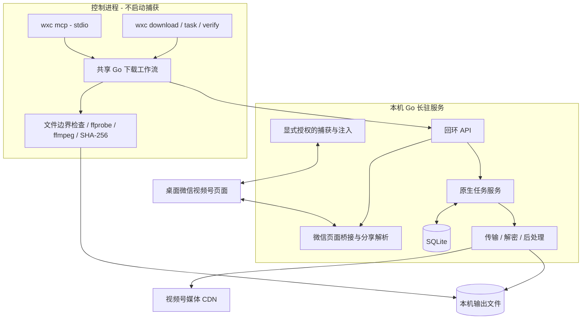
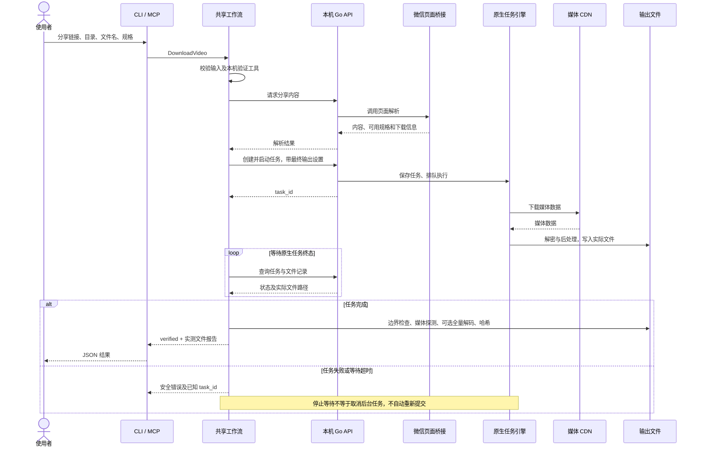

# wxchannels-kit

**本地运行的微信视频号下载工具：原生 Go CLI + MCP，共用任务引擎，下载后验证实际文件。**

面向 macOS Apple Silicon。源码与依赖保存在仓库内，不需要下载其他下载器程序；除本机工具链外，可以直接使用随附依赖构建。

> **源码公开 · 禁止销售。** 主项目采用 MIT + Commons Clause，不能当作允许无限制商用的纯 MIT 许可。使用前请阅读下方的[用途与责任声明](#用途与责任声明)及[许可证](<LICENSE>)。

## 功能

- **CLI / MCP 同核**：分享解析、任务创建、等待、验证走同一个 Go 工作流。
- **实际文件验证**：输出路径、文件大小、SHA-256、实际宽高/时长/编码；可完整解码检查。
- **持久化任务**：SQLite 保存状态，明确处理重复任务；控制端退出不冒充后台任务取消。
- **本地优先**：默认回环监听，配置、日志、会话记录和本机 CA 使用独立运行目录。
- **显式捕获**：裸命令只显示帮助，控制命令不隐式修改系统代理或证书信任。
- **源码自持**：依赖源码与注入资源随仓库保存，构建不依赖另一个项目的发行版程序或在线仓库。

## 设计原理

视频号分享链接不是一个可直接保存的普通 MP4 地址。工具通过经过本机捕获服务的桌面微信页面建立桥接，由页面解析内容和可用规格，再创建原生下载任务。

任务引擎负责传输、解密和后处理；控制工作流等待真实任务终态，再定位实际输出并调用 ffprobe / ffmpeg 验证。**拿到任务 ID 不等于下载成功，页面宣称的分辨率也不等于落盘文件的分辨率。**

### 架构图



### 下载时序图

前提：本机服务已启动，桌面微信的视频号页面已建立桥接。



更多模块边界、状态语义和权限设计见[设计文档](<docs/DESIGN.md>)。

## 快速开始

### 1. 准备环境并构建

需要：macOS Apple Silicon、Go 1.24 或更新版本、Apple C 编译工具、FFmpeg（包含 ffprobe）。建议使用当前稳定 Go 工具链。

```bash
# 如尚未安装 Apple 命令行工具，先运行并完成系统安装提示
xcode-select --install

# 已有 Homebrew 时安装 Go 和 FFmpeg
brew install go ffmpeg

git clone https://github.com/ByteFluffy/wxchannels-kit.git
cd wxchannels-kit
./scripts/build-local.sh
./dist/wxc --help
```

构建脚本使用 `-mod=vendor`、`GOPROXY=off`、`GOSUMDB=off`、`GOTOOLCHAIN=local`。工具链首次安装与微信/CDN 访问仍需要自行准备网络环境。

### 2. 启动服务

**该命令明确授权本进程使用本机 CA、安装/信任证书并配置系统代理，可能触发 macOS 权限确认。** 不要将整个程序用 `sudo` 运行。

```bash
./dist/wxc start --accept-system-changes
```

保持此终端运行，在桌面微信中打开一个视频号视频页面。已有系统代理启用时，工具拒绝覆盖；高级转发场景见[使用文档](<docs/USAGE.md#7-代理与证书>)。

### 3. 下载并验证

在另一个终端中运行：

```bash
./dist/wxc doctor
./dist/wxc download 'https://weixin.qq.com/sph/SHARE_ID' \
  --output "$HOME/Downloads/wxc" \
  --filename '我的视频' \
  --timeout 15m
```

CLI 下载默认完整解码检查。成功输出 JSON，包含任务 ID、实际文件路径、字节数、SHA-256、实际媒体参数及验证级别。

```bash
./dist/wxc task 1
./dist/wxc verify "$HOME/Downloads/wxc/实际文件名.mp4" --decode
./dist/wxc stop
```

`doctor` 在服务未运行、页面未连接或缺少工具时返回非零状态。`stop` 核对本机进程身份后正常终止服务，也可以在服务终端按 Ctrl+C。

## MCP

MCP 客户端启动同一个二进制即可，不需要 Python 包装器：

```bash
./dist/wxc mcp --api-base-url http://127.0.0.1:2022
```

仅提供四个工具：`download_video`、`get_video_task`、`verify_video`、`get_wxchannels_status`。MCP 不隐式启动捕获，也不提供证书安装、配置修改、云部署等管理工具。

参数、客户端配置示例、错误和退出语义见[使用文档](<docs/USAGE.md>)。

## 运行与开发

默认运行目录通常为 `~/Library/Application Support/wxchannels-kit`，可用 `WXC_HOME` 指定。运行数据、证书、日志、下载文件和编译产物不进入 Git。

```bash
./scripts/test-local.sh
```

测试使用临时运行目录、回环服务和生成的媒体样本。[设计文档](<docs/DESIGN.md>) 说明源码入口、扩展约束和维护方式。

### 使用边界

- 当前入口面向 macOS Apple Silicon 的普通视频号视频，不提供云服务或多用户授权边界。
- 默认只监听回环地址，不要向公网开放或做不可信端口转发。
- 超时或关闭 CLI/MCP 只停止等待；已提交的原生任务可能继续运行。
- 正常退出只关闭仍匹配本工具地址的系统代理；没有完整网络配置快照或 SIGKILL/断电恢复保证。
- 本机 CA 停止后可能仍被信任；如需移除，应在钥匙串中核对其名称/指纹后操作，不批量删除其他根证书。

## 文档

- [设计文档](<docs/DESIGN.md>)：架构、时序、模块与数据流、权限和维护约束。
- [使用文档](<docs/USAGE.md>)：安装、命令、MCP、运行数据及故障处理。

## 用途与责任声明

本工具用于个人学习研究及对**有权访问和保存的内容**进行合法备份。不得用于绕过付费或访问控制、侵害著作权或隐私、批量滥用、违法传播等用途。使用者应自行遵守适用法律法规及平台条款，并对自己的使用行为和后果负责；维护者不参与、不授权、不认可任何违法或侵权使用。

本软件按“原样”提供，不作可用性、特定用途适用性或不侵权保证。在适用法律允许的范围内，作者和维护者不对使用、无法使用或其他与软件有关的索赔、损失承担责任；本声明不排除法律规定不得排除的责任。

## 许可

主项目使用 **MIT + Commons Clause**：[LICENSE](<LICENSE>)。**禁止销售本软件，或以本软件主要功能作为实质价值的收费产品/服务**；额外许可须由权利人另行书面授予。随附组件仍受其各自许可证约束。
