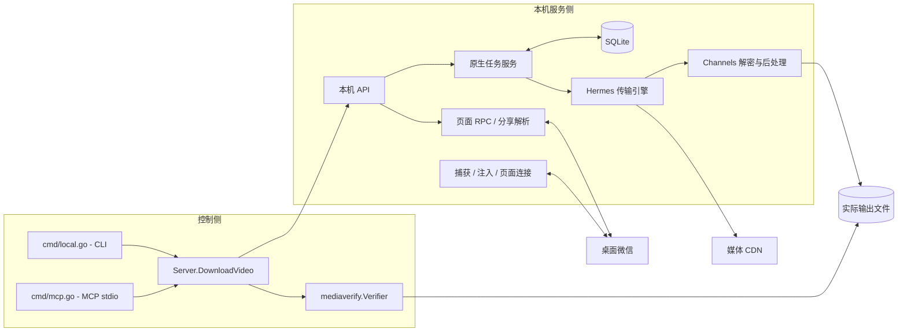
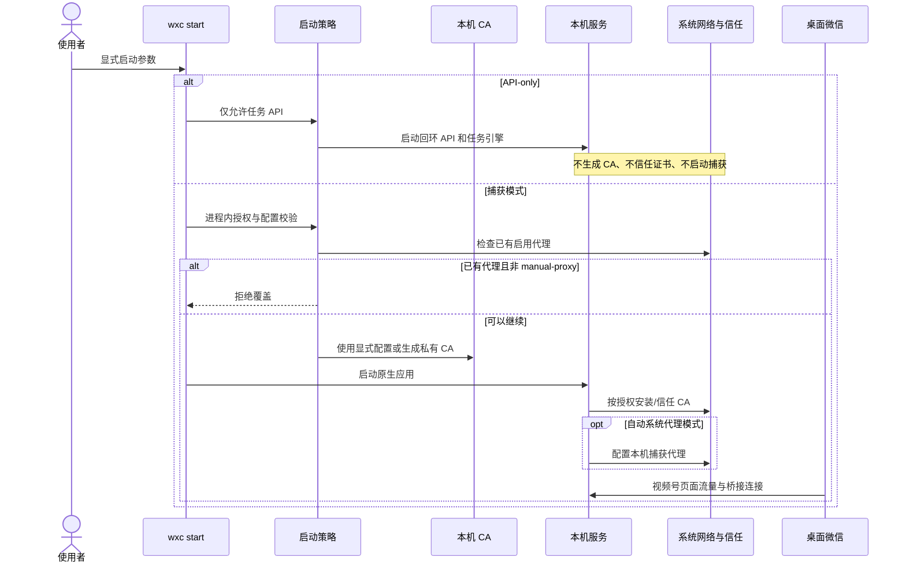

# 设计文档

[返回首页](<../README.md>) · [使用文档](<USAGE.md>)

## 1. 目标与边界

wxchannels-kit 是本地运行的 Go 工具。桌面微信页面、捕获桥接和原生任务引擎协作完成视频号下载，CLI 与 MCP 只提供不同的交互入口。

设计遵循四个原则：

1. **一个任务核心**：不为 CLI/MCP 分别实现解析器、下载器、解密器或任务数据库。
2. **进程职责明确**：长驻服务拥有任务与捕获生命周期，控制端不因一次下载请求隐式启用捕获。
3. **以输出为准**：任务完成之后仍需检查实际文件；标题、规格名、页面元数据不作为媒体质量的证明。
4. **有边界的副作用**：代理、证书信任和监听必须由显式启动流程拥有，失败和取消不应触发盲目重试或跨进程清理。

当前产品入口聚焦 macOS Apple Silicon 和普通视频号视频，不是云下载服务、多租户 API、系统级网络恢复管理器或跨平台桌面安装器。

## 2. 架构与进程边界

CLI 和 stdio MCP 在控制进程中执行同一个 Go 方法。运行于本机 API 内的 MCP 入口仍使用同一工作流和工具白名单，并不维护另一份任务状态。

服务通过 SQLite、任务状态和文件记录保存事实。控制端只取得所需投影，不能靠拼接标题猜测路径，也不在任务结束后私自搬移文件。

## 3. 模块职责

| 模块 | 主要入口 | 职责 |
| --- | --- | --- |
| 进程与命令 | [main](<../main.go>)、[CLI](<../cmd/local.go>)、[会话](<../cmd/session.go>) | 私有运行目录、命令参数、前台启动、进程身份核对与正常停止 |
| 共享工作流 | [local_download](<../internal/mcpserver/local_download.go>) | 输入校验、复用解析和任务创建、等待、定位输出、验证、结果投影 |
| 输入边界 | [local_inputs](<../internal/mcpserver/local_inputs.go>) | 官方分享链接、回环 API、文件名和输出路径约束 |
| 本机应用 | [application](<../internal/application/start.go>) | 组装数据库、适配器、捕获、页面桥接、API 与任务引擎 |
| 任务服务 | [download_task](<../internal/services/download_task.go>) | 原生任务创建、调度和持久化；不是控制端自建任务表 |
| Channels 适配器 | [model](<../internal/adapter/wxchannels/model.go>)、[postprocess](<../internal/adapter/wxchannels/postprocess.go>) | 原生媒体规格、资源、解密及最终后处理 |
| 传输 | [Hermes](<../pkg/hermes/>) | 原生 HTTP 下载、并发与任务资源处理 |
| 媒体验证 | [verify](<../internal/mediaverify/verify.go>) | 本地探测、完整解码、流式哈希、文件未被替换检查 |
| 捕获策略 | [启动策略](<../internal/application/local_policy.go>)、[API 策略](<../internal/api/local_policy.go>) | 启动前授权/监听检查，阻断遗留 HTTP 管理修改入口 |
| 本机 CA | [certificate_local](<../internal/services/certificate_local.go>) | 显式授权后读取配置的 CA 或生成本机独有 CA，不使用共享默认私钥 |

源码保留内部 module 路径 `wx_channel`，以避免与功能无关的全仓库 import 改动。仅注册 Channels 与单文件适配器，其他保留源码不等于已启用的产品功能。

## 4. 捕获启动时序

授权是进程内状态，不是写进配置后永久生效的开关。控制命令即使读到旧配置中启用捕获的值，也不会获得捕获权限。HTTP 配置/代理/服务修改和更新入口不能绕过命令行的授权拥有者。

## 5. 下载工作流

共享方法依次执行：

1. 规范化官方 HTTPS 分享链接，检查输出目录、文件名、规格标识与超时。
2. 检查所需 ffprobe/ffmpeg，创建本次输出根目录并解析符号链接。
3. 调用原生分享解析和 `download_wxchannels_video` 任务创建路径，传入**最终目录、文件名、规格及重复策略**。
4. 保留返回的原生任务 ID。提交结果不明确时不自动重试，以免产生重复任务。
5. 通过原生等待器等待终态；列表未含文件时调用详情取得权威文件记录。
6. 再次确认任务完成，检查候选文件位于请求的输出根目录内。
7. 执行媒体验证并形成结果；只有存在验证通过的视频文件才返回 `status: verified`。

完整请求时序见[首页时序图](<../README.md#下载时序图>)。

### 原生状态与验证状态

| 原生值 | 含义 |
| --- | --- |
| 0 | waiting |
| 1 | preparing |
| 2 | downloading |
| 3 | paused |
| 4 | merging |
| 5 | finished |
| 6 | failed |
| 7 | cancelled |

`verified` 是控制工作流的成功结果，不是新建的数据库任务状态。原生 `finished` 是开始验证的条件，而不是跳过验证的依据。

### 重复、超时与取消

- 默认 `error`，由使用者显式选择 `skip`、`overwrite` 或 `duplicate`。
- `skip` 仍等待并验证现有任务文件；它不是“找到记录即返回成功”。
- 超时覆盖解析、等待与验证，不代表后台任务已经取消。
- 已知任务 ID 时，即使工作流失败也保留该 ID 供查询；未知提交结果时提示先查任务，不能自动重新提交。
- 一份任务记录只有一个事实来源。不要以控制进程内的缓存替代原生状态。

## 6. 实际文件验证

验证器使用本机工具而不依赖页面元数据：

- 文件必须存在、为普通文件且非空。
- 任务文件经过真实路径解析及目录包含检查，拒绝向根目录外逃逸的符号链接。
- ffprobe 读取视频流、音频编码、容器时长、宽高及帧率，拒绝缺失有效视频的数据。
- `decode` 模式使用 ffmpeg 解码视频和存在的音频，错误不能伪装为成功。
- 计算完整文件 SHA-256，并检查验证期间的文件身份、大小、修改时间没有变化。
- 验证子进程仅允许本地 `file,pipe` 协议，不向控制结果透传原始 stderr；探测输出有大小限制。

CLI 下载默认 `decode`；独立 `verify` 与 MCP 下载默认 `probe`，由参数显式开启完整解码。报告如实标注验证级别。

## 7. 安全与运行边界

### 控制面

默认使用回环 API。控制客户端不经环境代理转发，也不跟随重定向，避免把任务创建或敏感参数意外发往其他主机。回环监听不等于多用户鉴权，不应暴露到公网或不可信端口转发。

`task` 与公共 MCP 状态工具只返回安全任务投影，不包括签名媒体 URL、解密密钥、Cookie、请求头或后端原始错误。日志仍是私密运行数据，不应直接提交或公开。

### 会话与停止

私有会话记录使用 PID、可执行文件路径、进程启动时间和随机所有者标记。停止前核对身份，避免 PID 复用导致误杀；清理记录时核对所有者，不移除后来新建进程的记录。不使用按名称批量终止。

### 代理与 CA

不带共享 CA/私钥，不从其他应用的目录自动选择证书。捕获只能使用显式配置或本机生成的 CA。自动代理模式拒绝覆盖已启用的系统代理；手动模式由使用者配置转发关系。

正常退出沿用捕获拥有者，只关闭仍匹配本工具地址的系统代理。它不是完整网络快照管理器：不保证还原关闭状态下保存的全部地址字段，也无法保证 SIGKILL、断电后的清理。本机 CA 的信任可在进程退出后保留，移除需由使用者精确核对。

## 8. 构建与维护

- [build-local](<../scripts/build-local.sh>)：先审计源码，再用随附依赖构建原生 ARM64 可执行文件；不自动下载 Go 工具链或 Go 模块。
- [test-local](<../scripts/test-local.sh>)：编译保留的包，运行相关单元测试，再以生成媒体和隔离 API-only 实例执行原生 CLI/MCP 集成测试。
- [sourceaudit](<../tools/sourceaudit/main.go>)：扫描源代码分发，拒绝 PEM 私钥和不应进入源码的运行文件；不会输出密钥内容。

更新依赖时应保留必要的内嵌资源和独立许可，检查 `.gitignore` 没有误忽略依赖的 cache/runtime/embed 源文件。随附 SunnyNet 的共享 CA 常量及帮助数据中的证书/私钥示例已清空；重新生成 vendor 后必须重新审计，不能恢复共享私钥默认值。

扩展入口或功能时优先复用现有服务和适配器：不复制下载状态机、不在 CLI 构造 CDN 地址、不绕过数据库改最终路径，不给 MCP 增加隐式代理/证书管理能力。功能与使用责任以[许可证](<../LICENSE>)及[首页声明](<../README.md#用途与责任声明>)为准。
